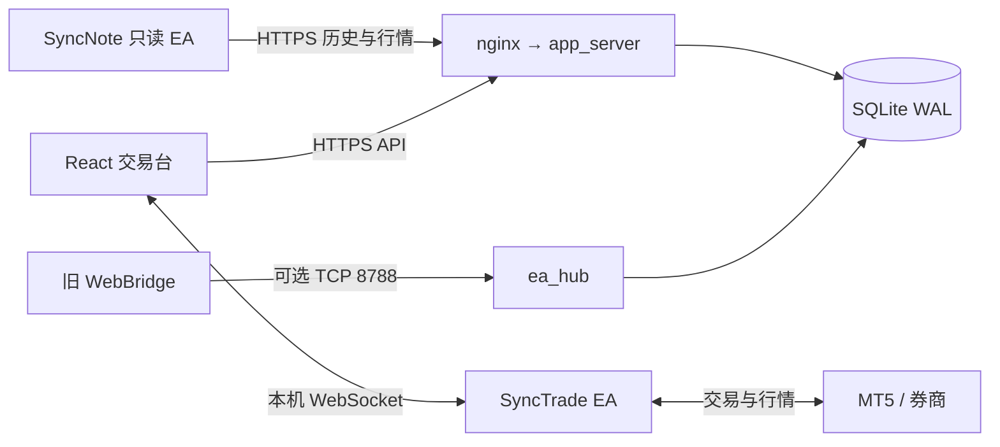

# 架构说明

> 同频（SyncNote）· 自托管交易社区
> 最后更新：2026-11-10

> 本文描述当前实现。升级、回滚和容量测量见 [架构迁移与容量验证](架构迁移与容量验证.md)。旧 EA 首版方案与当前能力的区别见 [本机 EA 交易架构设计](本机EA交易架构设计.md)。

## 1. 定位

一个只给熟人小圈子用的交易社区：注册登录、交易看板、逐笔复盘（K 线 + 画线 + 笔记）、私信与群聊交流，以及面向好友和群聊的复盘分享。

设计约束：

- **零运行时依赖**：后端只用 Python 3.9+ 标准库，不装 pip 包；SQLite 单文件存储。
- **小规模**：以熟人社区、单机部署为目标；100 人是设计目标，不是已确认的线上并发容量，SQLite 写入仍串行。
- **数据自持**：账号、成交、笔记都存在自己的服务器上，不接第三方服务。

## 2. 仓库结构

```
app_server.py         HTTP 入口、会话、事务和页面分发
app_config.py         配置（不创建目录）
app_runtime.py        hub 与目录刷新线程生命周期
database.py           自动关闭连接的事务上下文
migrations.py         显式版本迁移
app_bootstrap.py      原结构的幂等基线接管
routes/               复盘、行情、管理 HTTP 适配
accounts.py/social.py 账户与关系策略
review_service.py     历史与复盘读模型
trade_store.py        权威成交/旧摘要隔离
share_migrations.py   独立分享快照升级
observability.py      有界的进程耗时统计
ea_hub.py             MT5 EA 直连的多用户 hub（TCP 8788，NDJSON v1）
live.py               实时行情内存缓存（tick + 4 个周期 K 线）
journal.py            复盘笔记、交易复盘（trade_reviews）读写
journal_templates.py  个人模板、条目、常用语与复盘统计
chart.py              图表画线存档（chart_states）与消息分享（review_shares）
dm.py / groups.py     私信、群聊与复盘分享
sync_history.py       只读历史入库：原始 deal 保留，交易由服务器重建
bars.py               按券商轨道累积 K 线、覆盖与缺口
bar_sync_jobs.py      EA 行情区间同步任务与确认
device_pairing.py     SyncNote 网站与本机双向配对
market_symbols.py     券商品种目录
market.py             Dukascopy 参考行情（可选，默认不调度）
trade_time.py         券商时间 ↔ UTC 校准
auth_security.py      登录挑战、TOTP、限流、设备信任
client_address.py     反代场景下的真实客户端 IP
bootstrap_admin.py    首次初始化管理员（交互式）
resources/            前后端共享公开资源（后端运行时读取，前端构建时导入）

web/                  静态页面（原生 JS：看板、记录、个人中心、登录）
web/admin.html/js/css 管理后台（用户锁定、邀请码）
web/chart-src/        交易台前端源码（Vite + React 19 + @luxalgo/vela 0.9.3）
web/chart-src/src/features/  看板、EA 同步、社交通知、行情 hook
web/chart/            上面的构建产物（app_server 在 / 和 /chart 提供）
bridge/               当前 EA、共享 MQL 头文件及兼容组件；归属见 bridge/README.md
bridge/gateway.py     独立 WebBridge 本机网关（需要 pip 依赖；主程序不 import 它）
bridge/SyncNote.mq5   笔记版 EA：只读历史上传，无 DLL、无 socket、不交易
bridge/SyncTrade.mq5  交易版 EA：本机 WebSocket 看盘/下单 + 历史导出（由 SyncNoteLocal 派生）
bridge/SyncNoteHistory.mqh / SyncNoteJson.mqh  两个 EA 共享的历史分页与 JSON 模块
tools/bridge_push.py  本机 WebBridge → 同频 的同步器
tools/local_demo.py   本地演示实例（合成数据）
tools/syncnote-pull.sh 服务器一键更新
tests/run.py          全部 Python/EA 测试入口（每套独立进程）
tests/test_*.py       后端、HTTP 与 EA 回归测试；cpp/ 为模拟夹具
tests/smoke.py        完整 HTTP 集成测试（临时库）
docs/                 部署、交接、本文档
```

## 3. 运行时拓扑与生命周期



云端没有下单通道。当前 SyncTrade 支持实盘、模拟和挂单，最终能力由 EA 状态与 capabilities 决定。浏览器在已授权情况下代传历史与回填行情，旧 WebBridge/bridge_push 保留兼容接入。

`import app_server` 不创建数据库、不迁移、不启动线程。`main()` 先初始化数据库，再绑定 HTTP，进入 `Runtime` 启动可选 hub 和目录刷新线程。退出时关闭监听和客户端、取消任务、等待线程。`python3 app_server.py --migrate` 只迁移后退出。

迁移在 `BEGIN IMMEDIATE` 内执行；migration connection 避免 executescript 隐式提交。重建表时临时关闭 FK，提交前做完整 `foreign_key_check`。数据库版本高于代码时拒绝启动。HTTP 入口统一持有事务；`with connect()` 提交/回滚后关闭句柄。

| 版本 | 内容 |
|---|---|
| 3 | 接管原 version=2 基线，登记迁移 |
| 4 | 分离旧摘要，笔记与复盘外键转到 trade_keys |
| 5 | 分享内容/投递分表，群消息绑定独立快照 |

## 4. 数据流

### 4.1 网页数据

浏览器每 5 秒 `GET /api/state?view=board`，一次拿到：用户、成员、各自快照（持仓/成交）、交易动态、留言、通知。
这是轮询设计。响应包含可见历史，体积取决于好友数和成交量；不能假定每次只有 10 KB。扩容前需测量完整 HTTP 响应和峰值写入。

### 4.2 复盘

旧摘要通道保留以下复盘采集路径；原始 deal 重建后的任务由 §4.5 的历史通道统一管理。

1. 成交落库后，`journal.queue_missing` 把没有复盘图的交易排进 `trade_reviews`（pending）。
2. EA 回 `review_ticket` 时用 `CopyRates` 取四周期 K 线 → `POST /api/mt5/review`；EA 直连模式下由 `ea_hub` 用内存 K 线直接生成。
3. 服务端校验时间与覆盖范围后写 `status=ready` + `payload`（四组 K 线）。
4. 前端 `/chart?ticket=…` 调 `GET /api/chart/entry`，拿到交易、四周期 K 线、笔记、画线存档。

这份 `payload` 是**每笔交易各自一份的快照**。同一账户的 K 线怎么跨复盘累积、覆盖与缺口怎么记、
分享时用谁的数据，见 [K线数据与复盘覆盖方案.md](K线数据与复盘覆盖方案.md)（核心已落地，保留早期设计决策）。

### 4.3 实时行情与轨道读取

```
gateway /api/bars + /api/latest
        │  每 5 秒（首次 300 根，之后只补 3 根）
        ▼
bridge_push.py → POST /api/mt5/live（Bearer 连接码）
        ▼
live.py 内存缓存（每用户：tick + 1m/5m/15m/1h 各最多 3000 根）
        ▼
浏览器 GET /api/live?limit=N
```

行情图的历史首屏和向左翻页统一读取服务器当前数据轨道，不依赖 EA 是否在线或 EA 的首批缓存深度。`/api/market/bars?source=...&tf=M1&symbol=...&limit=6000&before=<UTC秒>` 按根数返回严格早于游标的同轨道 K 线，跨周末和长缺口仍能继续；响应 `has_more`、`earliest`、`next_before` 有实际查询依据。UTC 游标和券商墙钟的转换集中在 `bars.latest_utc`，前端不重复偏移。

复盘先按交易/分享锚点合并快照和同券商轨道，再通过 `/api/chart/bars?person=...&ticket=...&tf=M1&limit=2000` 按根数加载。`before` 向前、`after` 向后（互斥，UTC 秒），无游标取最新；保留交易/分享权限，不能用参数换券商或品种。拖动靠近两侧自动补段，也可点「加载更早 / 加载后续 / 最新入库」，断开 EA 仍可读取服务器数据。「定位开仓」保持原交易定位，分享仍按原切片打开。范围查询统一走 `bars.read_utc`，查询边界与闭盘时钟先转墙钟，K 线、覆盖与缺口出库转回 UTC。

网页 `liveHistory.ts` 保留已加载历史，本机 EA 只提供同来源实时增量；旧 `/api/live` 内存缓存没有原生 source/symbol 身份，轨道图不合并该缓存。页面显示已加载根数、轨道总根数及最早时间，支持手动加载更早数据和左侧自动翻页。历史按需累积，不用固定 60000 根截断，不一次下载整条轨道。断开 EA 后仍可读取轨道历史，不从别的券商补洞。Vela provider 注册键按 source 独立，避免全局 BarStore 在切换券商时复用别轨缓存。

网页连上本机 EA 后，`backfillBars.ts` 只在后台检查近 7 天，M1/M5/M15/H1 轮流分段；不恢复旧 v1 多年回溯游标、不锁图表，支持暂停/继续。之后每分钟检查新增已收盘 K 线，未确认旧空窗单独保留、每十分钟每周期最多复查一段；最新增量不等待周末等空窗。未决交易指令优先，账户/连接/用户改变时取消。历史轨道更早的数据仍按需向左加载。页面每 5 秒读取轨道尾部，发现落后、首轮补采结束或旧缺口实际修复时刷新近期窗口，避免只有当前实时一根与旧历史拼接。

入库的收盘判断用 `UTC 当前时间 + source_offset` 对比券商墙钟，审计时间仍为 UTC。`/api/market/backfill` 不能假定 CopyRates 返回了整个请求：按实际连续行登记 `have`，空结果保留待补，不把未返回的前缀、内部或尾部缺口标成完整。

Vela 0.9.3 的 `cell.chart` 没有 `setBars` 方法。`ChartHandle.applySeries` 在实时图使用 `setMarket({bars:深度})` 与 `historyComplete()` 扩展旧页；修复中间缺口时额外传 `data:[]` 强制从实时 provider 重载，原生渲染器保留蜡烛宽度，重载后用 `panBy` 恢复左侧定位。恢复位置用屏宽搜索，不能把跨周末的日历时差当作逻辑距离。异步更新期间的 viewport 事件不触发跨格联动或自动聚焦。静态复盘使用非空 `data`，所有相同基础周期格子一起补齐并各自保留视窗；静态 provider 共用更新后的缓存，切换周期清除上个周期的 inline data。不能把实时图切为非空离线 `data`，也不能只调用底层 renderer.setBars。

多周期的时间联动只从激活格传播，用公开 `chart.panBy` 平移并屏蔽程序性回声；点击定位通过公开 `chart.renderer.onClick`。禁止用 `getVisibleRange` 的返回值平移后再 `setVisibleRange`：返回范围只包含实际可见 K 线，跨长缺口或空白边界会重新拟合为很少的逻辑 K 线，造成两根巨宽蜡烛。默认各格缩放独立。单独开启「日期范围」后，只有激活格的真实拖动/缩放才通过 setVisibleRange 传播相同日期范围；它会改变其他周期的蜡烛宽度，默认关闭，优先于时间定位。数据维护、后台刷新和回放不传播范围。验收页 `tests/browser/viewportPan.html` 验证实际拖动、四周期蜡烛宽度和后台刷新；`tests/browser/liveHistory.html` 验证扩展旧页与后续实时事件，`?gap=1` 验证中间 100 根缺口补齐及缩放保持（路径均相对 `web/chart-src`）。

接口返回 Bar 为 **UTC 秒**，持久化 bars 表保存券商墙钟；复盘 K 线同样是 UTC（`journal.review` 里按 `closed_server - closed` 平移）。

### 4.4 聊天（私信、群聊与复盘分享）

主导航按从上到下统一为「交易、复盘、聊天」，群聊的未读数合并到「聊天」角标。创建/邀请码加入由聊天中的 `GroupEntry.tsx` 对话框完成；群名、头像、公告、邀请、成员和退出由右侧 `GroupDetails.tsx` 管理，群主操作按已有接口权限显示。原 `/chart?group=<邀请码>` 链接继续有效，加入后直接选择对应群会话，已移除重复的 `GroupsPanel.tsx`。

右栏「聊天」由 `ChatDock.tsx` 提供：会话列表、消息流和可切换的资料/成员栏，可展开为大窗口。私信合并文本与复盘分享，群聊支持文本、提及、撤回和交易复盘卡片。旧留言流保留在代码中，聊天主入口使用私信与群聊。

自己的复盘面板与聊天输入栏共用 `ReviewShareDialog.tsx`：搜索、多选好友和群聊，可附带 500 字留言；从聊天打开会预选当前会话。打开选择窗口时冻结复盘切片，成功目标标记已发送，失败目标保留选择。群分享也保存留言，并在同一事务中创建群快照、为全部成员生成投递；好友分享 20 人限制与群人数限制分别检查。

消息支持引用回复和六种表情回应（👍、❤️、😂、🎉、👀、✅）。引用和回应只能作用于同一私信会话或同一群组；撤回的群消息不会再返回原文或引用原文。私信分享卡片沿用原分享记录，暂不支持对卡片引用或回应。

聊天实际可见时，会话列表每 15 秒更新，当前会话每 4 秒轮询；收起聊天、切去其他面板、打开好友管理或浏览器后台时暂停读请求。同一会话跳过重叠轮询，慢请求完成后仍可展示结果；写入完成后再取一次最新记录。读取记录会更新已读状态。在线状态来自网站 `presence`，不拿 MT5 在线状态替代。搜索仅过滤已加载的最近记录；切换会话、交易/复盘面板或好友管理时，保留当前页面期间各自的草稿、引用与会话；刷新页面不保留草稿。发送失败保留输入。中文输入法确认不会触发发送，Enter 发送、Shift+Enter 换行。消息日期和时间统一使用 `stamp()`，跟随图表的显示时区。

一条分享在发送时抓三样东西（`review_snapshots.snapshot`，JSON）：

| 字段 | 含义 |
|---|---|
| `anchor_ms` | 分享人点击分享那一刻，**激活格子可见窗口的中点**时间（毫秒） |
| `timeframe` / `layout` | 当时那个格子的周期与整体布局 |
| `document` | 当时的整份画线文档（已剔除自动生成的开平仓标注） |

收件人点 `/chart?share=<id>`，`/api/chart/entry` 校验「收件人或发件人」后，**用切片里的文档和锚点回放**，而不是读分享人后来改过的 `chart_states`；前端把它当只读复盘渲染（隐藏绘图工具栏、锁定所有画线）。空笔记/画线也被冻结；旧消息缺失的快照在迁移时一次性冻结。

打开私信时，`dm.thread()` 把本次返回的收到分享标为已读；旧入口仍可通过 `POST /api/reviews/share/seen` 单独更新。群交易卡片经 `/api/groups/open` 校验群成员权限后打开，新加入成员也可取得分享。打开复盘使用新标签页，保留原交易台的本机连接。

每次发送创建新的 `review_snapshots`，数据库触发器拒绝更新内容。`review_shares` 保存 snapshot_id/recipient/seen，按 `(snapshot_id,recipient)` 唯一；`review_share_entries` 提供联合读视图。群卡片绑定 `review_snapshot_id`，后来成员补领原快照。群分享读取验证当前成员资格及消息未撤回，群投递不混入私信未读。

迁移保留旧 share id，并归档原表为 `legacy_review_shares`。升级前被覆盖的内容无法恢复，旧投递也无法可靠推断原本属于私信还是群。快照冻结笔记、画线、锚点和留言；成交与 K 线仍从当前数据源读取，不是行情永久副本。

### 4.5 历史通道（只读成交入库）

两个入口，同一套入库逻辑（`sync_history.ingest`）：

```
SyncNote（笔记版 EA）── HTTPS ─┐
                              ├─→ POST /api/mt5/history-sync（Bearer 连接码）
SyncTrade（交易版）+ 浏览器 ───┘   POST /api/mt5/history-import（网站会话 + website_user_id）
                                            ▼
                                  sync_history.py：原始 deal 落库 → 按持仓重建交易
                                            ▼
                            trades（source=syncnote-history.v1）+ mt5_history_issues
                                            ▼
                        queue_review_jobs → 交易台「已复盘/未复盘」与复盘图任务
```

要点：

- **只收成交**。请求白名单里没有余额、净值、持仓字段；出现就整批拒绝。原始 deal 全保留（手动单、其他 EA、部分平仓、反转、独立手续费/资金变动）。
- **去重键**是「券商服务器 + 账户 + deal ticket」（`mt5_raw_deals` 主键），批次另有 `batch_id + fingerprint`：重放同一批返回缓存的 ACK，同批次改内容返回 409。
- **不编造开仓价**。重建前要证据：所有成交指向同一个持仓起点锚点、最早一笔是原始开仓订单、开仓那一秒所在的分页已确认完整（`mt5_history_coverage`）。缺证据就把该持仓标成 `context_unverified`，只保留原始记录。
- **券商改数据会失效旧结果**：派生交易被重新计算；如修正后不再成立，旧交易标 `invalidated`、不再出现在历史里，但**不删除**被笔记/画线/分享引用的父交易。
- **复盘图按需补**：`review_job` 一次一个，EA 取四周期 K 线后回 `POST /api/mt5/review`；上传失败不回滚已确认的成交历史。
- **两页同源**：交易台底部历史、`/history` 日历及 `/api/history` 均使用 `history_for` 的持久化交易，hub 内存里的最近 500 笔不能覆盖完整历史。`history_snapshot` 分开返回账户快照 `updated` 与历史批次 `history_synced_at`；确认过的空历史也区别于从未同步。
- **日历复盘状态**：逐笔、日格计数、日期汇总及筛选使用服务端 `journal.reviewed`（非空笔记正文或真实画线），不以空笔记行、分类标签或已有 K 线快照代替。笔记分类接口慢或失败不阻塞交易列表；好友权限撤回后清除旧分类和状态。
- **只读通道忙**：本机尚未发送读取帧的互斥拒绝带 `history_read_busy`，历史同步固定范围和游标不变，1.5 秒后重读；不把复盘读取 busy 伪装成缺 K 线。HTTP 上传失败和普通读取超时仍需显式重试。行情补采失败不再永久阻挡用户已授权的自动历史续传。

## 5. 模块职责

### 5.1 时间对齐层（broker clock → UTC）

`syncnote-history.v1` 交易按其自身 `server` 选择券商规则或同券商观测时钟；旧的用户级 WebBridge 时钟不能覆盖另一个券商。没有适用的观测或规则时，可用该交易已验证范围内的 `history_offset_seconds` 显示估计时间，保留 `time_estimated`。不能让无关或过期观测把已入库交易的日期清空，导致日历漏计。

券商给的是「服务器墙钟」，不同券商偏移不同（这台 EasyTradingOnline 是 UTC+3），
而交易/复盘记录的是真实 UTC。**只有一个地方允许把墙钟换成 UTC**：

| 位置 | 职责 |
|---|---|
| `trade_time.py` `RULES` | 每个券商服务器的规则（`offset_seconds`，可扩展成 DST 规则） |
| `trade_time.offset_for(db, source)` | 唯一入口：规则 → `source_clock` 观测值 → 0 |
| `broker_clocks` | 从 EA 心跳里测出来的偏移（`record_clock` 维护） |
| `bars.source_clock` | 每条券商轨的偏移快照，`bind_feed` 时自动写入 |
| `bars.to_utc(payload, offset_sec)` | 出库时把 K 线、缺口、`from/to` 一起平移 |

约定：

1. **库里存墙钟，出库一律 UTC**（`/api/chart/bars`、`/api/market/bars`、`/api/chart/tracks`、`/api/live`）；
   前端不参与换算，图表时间轴就是本地时间。
2. 接入新券商时**只需要登记一条规则**（或等一次 EA 心跳自动学到偏移），不要在每个接口里各写一遍。
3. 有夏令时的券商（如 EET 一类）要在 `RULES` 里给 `zoneinfo` 规则，不能用固定偏移；
   固定偏移只适用于常年不变的服务器，且要在规则里写清来源与观测时间。
4. 复盘快照 `trade_reviews.payload` 在 `journal.review()` 里已经平移过，属于同一层，不要重复减。


| 模块 | 职责 | 注意 |
|---|---|---|
| `app_server.py` + `routes/` | HTTP 入口与领域路由 | 会话/事务统一，复盘、行情、管理按模块注册 |
| `ea_hub.py` | 多租户 EA 会话、按 token 识别用户、成交配对、复盘图生成 | 跑在 `app_server` 内的守护线程（asyncio） |
| `live.py` | 实时行情缓存 | 纯内存，重启后由采集端重新 bootstrap |
| `journal.py` | 笔记、复盘读写、待办队列 | `review()` 会把券商时间平移成 UTC |
| `sync_history.py` | 只读历史入库：原始 deal → 服务端重建交易 | 只收成交字段；缺证据宁可标记，不猜开仓价 |
| `local_ea.py` | 把 `bridge/` 的 MQ5 + MQH + 说明打成三个源码包 | 打包 SyncNote 时会拒绝 `#import`/`OrderSend`/`SocketCreate` |
| `chart.py` | 画线存档、消息分享 | 存档上限 512 KB，校验 `version==1` |
| `trade_time.py` | 券商墙钟 → UTC | 观测窗口外的历史成交需要 `time_basis:'utc'` 直通 |
| `market.py` | Dukascopy 日线缓存 | 默认不调度，仅在参考行情模式使用 |

## 6. 数据库

单文件 SQLite（WAL），路径 `DATA_DIR/board.sqlite3`。

| 表 | 内容 |
|---|---|
| `users` | 账号、昵称、头像、密码（PBKDF2）、隐私开关、`onboarding_step`、**`locked`**（停用标记） |
| `sessions` | 登录会话（sha256(token) → user），`sudo_until` 记录管理后台的二次验证窗口 |
| `follows` / `friend_edges` | 旧关注兼容数据 / 当前好友关系与可见性状态 |
| `mt5_links` | 每用户一条 MT5 连接码（sha256）与绑定账户 |
| `snapshots` | 账户快照：余额/净值/持仓/在线 |
| `trades` | 原始 deal 重建的权威成交（UTC + 券商时间） |
| `trade_reviews` | 复盘图任务与结果（pending/ready + 四周期 K 线） |
| `trade_notes` | 笔记正文 + 分类标签 |
| `chart_states` | 交易台上的画线/布局存档（Vela state document） |
| `review_snapshots` | 不可变视图、画线、笔记、留言与可选群身份 |
| `review_shares` | 投递 id、snapshot_id、收件人、已读 |
| `legacy_trades` / `trade_keys` | 旧摘要与稳定交易外键 |
| `schema_migrations` | 已提交的数据库升级版本 |
| `mt5_raw_deals` | 历史通道的原始成交，主键 `(person, account_key, deal_ticket)` |
| `mt5_history_batches` | 已确认批次（`batch_id` + 内容指纹 + 缓存 ACK），重放幂等 |
| `mt5_history_coverage` | 每个账户已确认完整的历史区间，重建交易时的证据 |
| `mt5_history_issues` | 无法重建的成交及原因（`context_unverified` 等），前端可查 |
| `events` | 交易动态（开/平仓），按 `event_key` 去重 |
| `messages` | 交流板留言 |
| `invites` | 邀请码：`code_hash`、`code_plain`（未使用时保留明文）、批次、备注、过期、`revoked`、`used_by`/`used_at` |
| `registration_invite` | 改名前的单码邀请（已迁移进 `invites`，仅作历史） |
| `broker_clocks` | 券商时区校准记录 |
| `market_days` | 参考行情日线缓存 |
| `auth_*` / `security_*` / `mfa_*` | 登录挑战、限流、MFA |

## 7. HTTP API

认证：Cookie `tongpin_session`（网页）或 `Authorization: Bearer <连接码>`（采集端）。所有写接口校验 `Origin`。

| 分组 | 接口 |
|---|---|
| 账号 | `POST /api/login`、`/api/register`、`/api/logout`、`/api/password`、`/api/profile`、`/api/settings`、`/api/onboarding` |
| 安全 | `GET /api/login-challenge`、`POST /api/mfa/setup|enable`、`/api/sessions`、`/api/sessions/revoke`、`/api/trusted/revoke` |
| 管理 | `GET /api/invite`、`POST /api/invite/rotate`、`GET /api/admin/users` |
| 看板 | `GET /api/state?view=board`、`POST /api/messages`、`GET /api/users?q=`、`POST /api/follow|unfollow` |
| 交易 | `GET /api/history?person=`、`GET /api/journal?person=`、`POST /api/journal` |
| 复盘 | `GET /api/trade-review`、`POST /api/trade-review/request`、`GET /api/chart/entry`、`POST /api/chart/state` |
| 消息 | `GET /api/reviews/inbox`、`POST /api/reviews/share`、`POST /api/reviews/share/seen` |
| 私信 | `GET /api/dm/threads`、`GET /api/dm?with=<id>`、`POST /api/dm`（可带 `reply_to`）、`POST /api/dm/reaction`（`to,id,emoji,active`） |
| 群聊 | `GET /api/groups`、`GET /api/groups/messages`、`GET /api/groups/members`、`POST /api/groups/message`（可带 `reply_to`）、`POST /api/groups/reaction`（`group,id,emoji,active`）、`POST /api/groups/share`（可带 `snapshot`、`message`）、`POST /api/groups/open` |
| 采集端 | `POST /api/snapshot`、`/api/mt5/review`、`/api/mt5/live`、`GET /api/live`、`GET /api/mt5/status`、`POST /api/mt5/token|unlink|redeem` |
| 历史通道 | `POST /api/mt5/history-sync`（EA，Bearer）、`POST /api/mt5/history-import`（浏览器，会话 + `website_user_id`）、`POST /api/mt5/history-review`、`GET /api/mt5/history-job` |
| 源码包 | `GET /downloads/syncnote.zip`（笔记版）、`/downloads/synctrade.zip`（交易版） |
| 管理 | `POST /api/admin/sudo`（二次密码）、`GET/POST /api/admin/invites`、`POST /api/admin/invites/revoke`、`GET /api/admin/users`、`POST /api/admin/users/lock` |
| 健康 | `GET /api/health` |

`/api/snapshot` 同时接受两种时间口径：券商墙钟（旧采集程序）和已换算 UTC（`time_basis:'utc'`，bridge/hub 用）。


## 7.1 邀请码与管理后台

注册采用**邀请制**：没有邀请码无法注册。

```
用户：登录 → /admin（仅管理员，未登录跳登录页并带 next）
     → 二次密码（sudo，15 分钟窗口）
     → 「用户 / 邀请码」两个页签
```

### 邀请码

- 一次可生成 1–100 个，格式 `XXXX-XXXX-XXXX`（去掉 I/L/O/U/0/1）
- **一人一码、一次性**：注册时 `UPDATE invites SET used_by=? WHERE used_by IS NULL` 原子占用
- **未使用的码保留明文**（`code_plain`），可随时复制/导出 `.txt`；被使用或作废后清空
- 可设过期（天数，0 = 永久）、可备注批次、可作废未使用的码
- 库里只存哈希，明文仅用于"还没发出去"的码，降低泄露面

### 安全边界

| 措施 | 说明 |
|---|---|
| 角色 | 只有 `ADMIN_USERNAME` 能进，其他人访问 `/admin` 返回 **404** |
| 二次验证 | 进页面后重新输一次登录密码，`sessions.sudo_until` 记 15 分钟窗口 |
| 限流 | 密码错误 5 分钟内最多 10 次 |
| 用户锁定 | 即时删除该用户所有会话；登录与 EA 上报都返回 403 |
| 不能锁自己 | 管理员账号本身不可锁定 |

### 用户页签

列出 用户名 / 昵称 / 注册时间 / 最近同步 / 复盘数 / 状态（正常 / 已锁定 / 管理员），可锁定或解锁。
锁定后：在线会话立即失效、无法再登录、EA 推送被拒（数据不会写入）。

## 8. 前端

### 页面

| 路径 | 文件 | 说明 |
|---|---|---|
| `/`、`/chart` | `web/chart/` | **交易台**（React + Vela）：顶栏 + K 线 + 右侧五面板 + 底部动态 |
| `/board` | `web/index.html` | 旧看板（保留，信息与交易台右栏重复） |
| `/history` | `web/history.html` | 完整交易记录、日历、复盘入口 |
| `/profile` | `web/profile.html` | 资料、隐私、邀请码、连接码、改密 |
| `/login`、`/register` | `web/auth.html` | 登录/注册（含图案验证） |
| `/welcome` | `web/welcome.html` | 四步引导 |

### 交易台（`web/chart-src/src`）

```
App.tsx                 顶栏 / 主体 / 右栏 / 底栏，数据轮询与目标交易选择
ChatDock.tsx            私信 / 群聊、引用回复、表情回应与复盘卡片
GroupEntry.tsx          聊天内创建 / 邀请码加入群的对话框
GroupDetails.tsx        聊天资料栏中的群公告、邀请与成员管理
ReviewShareDialog.tsx   搜索、多选好友和群聊，附带留言与发送结果反馈
ReviewNotebook.tsx      自由章节、检查项、个人模板与常用语
notebookModel.ts        章节结构、排序、模板副本与个人推荐排序
LocalTradePanel.tsx     本机 MT5 连接、配对、下单与指令回报
trade/OrderTicket.tsx   市价/挂单票（手数、SL/TP、风险预览、解锁、确认弹窗）
trade/risk.ts           风险与盈亏比计算（方向不对时不给数字）
trade/localSubmit.ts    单票 → EA 指令，等待回报并映射结果
BottomDock.tsx          底部「持仓 / 挂单 / 历史」，历史里显示 已复盘 / 未复盘
DrawingFavs.tsx         顶部画图收藏栏（镜像 Vela 左侧工具栏的收藏）
SettingsMenu.tsx        顶部「设置」：深/浅主题、显示时区、图表语言
ui/prefs.ts             本机偏好存储（localStorage `sn-ui.v1`）+ 写 <html data-theme>
lib/time.ts             显示时区格式化（stamp / fmtClock / zoneOffsetLabel）
lib/zones.ts            设置里列出的 10 个时区
styles.css              设计令牌：:root 深色、:root[data-theme='light'] 亮色
vela/ChartWorkspace.tsx Vela 工作区封装（布局、周期、画线锁定、时间定位、开平仓标注、主题/时区/语言跟随）
vela/provider.ts        ReviewProvider（静态复盘 K 线）+ LiveProvider（实时轮询）
vela/drawingTools.ts    画图工具的中文名与图标
vela/LayoutMenu.tsx     图标式布局选择器 + 6 种同步开关
vela/TfMenu.tsx         周期菜单
vela/layouts.ts         12 个非对称布局注册
vela/indicators/        SMC 结构、前日高低点、hidden OB（原生指标）
```

构建：`npm run build` → `web/chart/`；`base` 默认指向 jsDelivr（国内到服务器的链路只有 ~20 KB/s，CDN 快 15 倍）。本地调试用 `CHART_BASE=/chart/ npm run build`。

图表页的 CSP 单独放开：`style-src 'unsafe-inline'`（Vela 注入 `<style>`）+ `script-src/style-src/font-src https://cdn.jsdelivr.net` + `connect-src ws://127.0.0.1:18765`（本机 EA）。

### 自由复盘笔记

自由正文和标签保留，章节按稳定 ID 有序存储，可自定义标题、检查状态和正文。`trade_note_sections` 与旧 `trade_notes` 分离，旧客户端遗漏 sections 字段时不会清空章节。个人模板/常用语保存在服务器，使用当前登录用户隔离；模板只保存标题顺序，套用时追加新 ID，不覆盖原笔记。推荐章节按不同已保存交易的实际使用计数，不按保存次数刷频。空模板不计为已复盘；分享只读沿用已有复盘权限，私人模板库不会随笔记分享。接口、验收与后续图形证据联动计划见 [自由复盘笔记与模板开发方案](自由复盘笔记与模板开发方案.md)。

### 交易台几个约定

- **复盘标注**：打开一笔复盘时，在每格画一条「开仓 → 平仓」虚线 + 两个价格标签；这些标注在保存画线存档前会被过滤掉，不会污染用户自己的画。
- **已复盘判定**：不是「复盘图生成好了」，而是**写过笔记正文、章节内容或检查过章节**或**在图上画过东西**（`journal.reviewed`）；否则显示「未复盘」。
- **画图收藏**：顶部只镜像 Vela 左侧工具栏「添加到收藏」的结果，存在 `localStorage` 的 `sn-chart-favs`。
- **点复盘**：切图表到复盘模式、定位开仓时间、右栏自动切到「复盘」页签。
- **限价/止损**：本机 EA 协议首版没有挂单，两个按钮禁用，避免"选了限价却发市价"。
- **指标库排序**：Vela 的指标库按**标题** A→Z 排（`Intl.Collator`），不是按注册顺序；所以排位靠标题前缀控制——`★ bigwolf` → `★ hidden OB` → 其余。`bigwolf-macd` 由代码配对，不进清单。
- **hidden OB 的低周期依赖**：只读当前图表同券商的一分钟数据，通过 provider 的 `getIndicatorBars` 按主图最后一根收盘边界分页读取（默认 20000 根，最多 100000）；复盘沿用 `/api/chart/bars` 的交易/分享授权，行情沿用 `/api/market/bars` 的 source。不得把 H1/M5 代入一分钟算法，不读取回放边界以后的分钟；M1 更新会通知高周期指标，历史 OHLC 修正会重算。未缓解区向右延伸，枢轴平台取最右侧极值，与仓库 Pine 原版一致。

### 外观设置（主题 / 时区 / 图表语言）

入口在顶栏右侧「⚙ 设置」，三项都存在浏览器 `localStorage.sn-ui.v1`，**不上云、不跨设备**，改完立即生效。

| 项 | 取值 | 生效方式 |
|---|---|---|
| 主题 | 深色（默认）/ 浅色 | `ui/prefs.ts` 写 `<html data-theme>`，`styles.css` 的令牌切换整套配色；同时 `ws.setTheme()` 换 Vela 自己的配色 |
| 显示时区 | `auto` + 9 个 IANA 时区（默认 `Asia/Shanghai`） | `lib/time.ts` 的 `stamp()` 等格式化全部走它；同时 `ws.setTimezone()` 换图表时间轴 |
| 图表语言 | 中文（默认）/ English | `ws.setLocale()`，只翻 K 线图内部（工具栏、指标名、右键菜单），不翻本站界面 |

三条实现约定：

1. **配色只用令牌**：`styles.css` 顶部 `:root` 是深色，`:root[data-theme='light']` 是同一个令牌表的亮色值；
   组件里写字面量十六进制颜色，亮色主题下就会留一块深色补丁。
2. **时间只有一个来源**：页面显示和图表时间轴都用同一个「显示时区」，否则「点复盘跳到那根 K 线」会错位。
   服务端与数据库里**始终是 UTC 秒**，时区只是显示层。
3. **首屏不闪**：`web/chart-src/index.html` 的内联脚本在建 React 之前读 `sn-ui.v1` 写 `data-theme`；
   键名和字段名与 `ui/prefs.ts` 必须一致。
4. **存档不回放配色**：Vela 的画线存档里带 `rendererConfig`（生成存档那一刻的背景/网格/文字/涨跌色）。
   套用存档前一律剥掉、保存时也不再写入——否则「面板已经换成浅色、K 线还是黑的」，
   而且分享出去的复盘会强行用分享者的主题。配色只认「设置 → 主题」。

默认值写死为 深色 + `Asia/Shanghai`，与老版本行为一致（老用户升级后看到的东西不变）。

## 9. MT5 接入

### 连接码

每个用户一条，`POST /api/mt5/token` 生成，只存 sha256。重新生成会让旧码立即失效（正在同步的 EA/bridge_push 会 401）。

### 两个 EA：SyncNote 与 SyncTrade

界面全在网站上，数据全来自用户自己的 MT5。源码在 `bridge/`，服务器按需打包成两个下载包（`local_ea.source_package`），入口页是 `/local-ea`。

| | SyncNote（笔记版） | SyncTrade（SyncNote Pro · 交易版） |
|---|---|---|
| 面向 | 只要复盘、笔记、分享 | 还想在网页看盘下单 |
| 入口 | `bridge/SyncNote.mq5` | `bridge/SyncTrade.mq5`（由旧 `SyncNoteLocal.mq5` 派生） |
| 上传 | EA 自己发 HTTPS（`/api/mt5/history-sync`） | 浏览器代传（`/api/mt5/history-import`） |
| 关闭浏览器 | 继续同步 | 暂停，下次打开续传 |
| 依赖 | 纯 MQL5，无 DLL、无 socket、无交易函数 | 系统 DLL（Winsock + bcrypt）、本机 WS 18765、配对授权 |
| 凭据 | 个人中心生成的连接码 | 网页一次性配对码 |
| 共享 | `SyncNoteHistory.mqh` / `SyncNoteJson.mqh` / `SYNCNOTE_PROTOCOL.md` | 同左 + `SyncNoteLocal*.mqh` |

打包时的硬约束：SyncNote 包内一旦出现 `#import`、`OrderSend`、`CTrade`、`SocketCreate`，`local_ea.source_package` 直接抛错、接口返回 503 —— 宁可下载不到，也不发一个能交易的"只读版"。

SyncNote 1.011 的共享行情调度在 `SyncNoteBars.mqh`：首次成交 ACK 完成绑定后才上传 K 线，四周期轮询检查最近 7 天，之后持续同步新增已收盘行。旧多年回溯断点不恢复；站点/采集码 hash、账户、券商及品种共同隔离 v2 断点。空结果和缺口只作未确认，后台冷却复查；历史 ACK、行情 ACK 与状态落盘分别处理。源码包还拒绝任意系统 include 与 `CTrade` 声明，保证本地依赖完整收集。共享历史时间属性读取失败、查询期间切账户的异常都保留游标，这两项同时进入 SyncTrade 1.106。

旧的单文件采集程序已下线（不再提供 `/downloads/syncnote-local.zip` 与 `/downloads/SyncNoteSync.mq5`），但它**曾经同时上传余额与持仓快照**，新用户不要用。

### WebBridge 源码（bridge/）

原来的 `trade_dashboard/live_data/ea_bridge` 已整体迁入 `bridge/`，本仓库自包含，不再需要外部项目：

| 文件 | 作用 |
|---|---|
| `bridge/WebBridge.mq5` | MT5 EA：socket 连本地网关，推 tick/bar/账户/持仓/成交 |
| `bridge/gateway.py` | 本地网关：TCP 8788 收 EA，REST 8790 + WebSocket 给本机程序 |
| `bridge/PROTOCOL.md` | NDJSON v1 协议 |
| `bridge/fake_ea.py` | 无 MT5 时的模拟 EA，用于联调 |
| `bridge/requirements.txt` | fastapi / uvicorn / pydantic / websockets / httpx |

启动：`pip install -r bridge/requirements.txt && python bridge/gateway.py`。
它是**独立组件**，主程序（`app_server.py`）仍然零依赖，不要 import 它。

### 方式一：EA 直连 hub（8788）

- `WebBridge.mq5` 把 `InpHost/InpPort/InpToken` 指向服务器
- 协议：NDJSON v1（`hello` → `account/positions/orders/bars/trade/heartbeat`）
- `ea_hub` 按 token 绑定用户，成交配对后落 `trades` 并用内存 K 线生成复盘图
- 需要安全组放行 TCP 8788；**目前是明文**，上 TLS 后复用证书

### 方式二：本机推送（推荐先跑通）

- 本机已有 WebBridge（`gateway.py`，REST 在 127.0.0.1:8790）
- `python tools/bridge_push.py --token <连接码> --syncnote https://域名`
- 每 5 秒：读 `/api/accounts|positions`、`ea_bridge.db` 的成交 → `POST /api/snapshot`；读 `/api/latest`+`/api/bars` → `POST /api/mt5/live`
- 不碰 MT5、不写 bridge 数据库

## 10. 部署

当前生产：**43.103.49.141（香港，Ubuntu 24.04）**，旧的 47.79.243.184（新加坡）已停止。

```
/SyncTrade                 git 检出的仓库（https://github.com/26055423/SyncNote.git，公开仓库匿名拉取）
/SyncTrade/data            SQLite + 初始管理员密码文件（属主 tongpin，750）
/etc/systemd/system/syncnote.service   User=tongpin，127.0.0.1:18886
/etc/nginx/conf.d/syncnote.conf        80 跳 443 + 443 ssl → 18886，含 gzip 与 X-Auth-Client
/etc/nginx/ssl/sync-trade.top.*       acme.sh 安装的证书（ECC，自动续期）
/etc/systemd/system/syncnote.service.d/https.conf   PUBLIC_ORIGIN / COOKIE_SECURE
/usr/local/bin/syncnote-pull           git pull + 重启 + 健康检查 + 失败回滚
```

更新：`sudo syncnote-pull`。
备用（无 git 权限时）：本地 `pwsh -File tools\deploy.ps1` 打包上传。

关键环境变量：`DATA_DIR`、`PUBLIC_ORIGIN`、`COOKIE_SECURE`、`ADMIN_USERNAME`、`TRUSTED_PROXY_CIDRS`、`EA_HUB_ENABLE`、`EA_HUB_PORT`。

### 运维现状（2026-11-01）

| 项 | 状态 |
|---|---|
| HTTPS | `https://sync-trade.top`，Let's Encrypt ECC，acme.sh 每天 4 次检查、续期后 reload nginx |
| HTTP | 80 全量 301 到 https，保留 `/.well-known/acme-challenge/` 供续期 |
| 证书文件 | `/etc/nginx/ssl/sync-trade.top.{crt,key}` |
| SSH | **已关闭密码登录**（`PasswordAuthentication no`，root 也仅密钥） |
| 数据库权限 | `board.sqlite3` 600、`/SyncTrade/data` 750，属主 `tongpin` |
| 防火墙 | ufw 未启用，靠云安全组（22 / 80 / 443 / 8788） |
| 自动更新 | `unattended-upgrades` 已启用 |

生产环境（2026-10-30 起）：`PUBLIC_ORIGIN=https://sync-trade.top`、`COOKIE_SECURE=1`，写在 systemd drop-in 里，不放在仓库。

## 11. 本地开发与测试

```bash
python tools/local_demo.py --port 18900    # 演示实例（合成交易/K线/消息），登录 admin / syncnote-demo-2026
python tests/smoke.py                      # 153 项集成检查，临时目录、随机账号
cd web/chart-src && npm run dev            # 图表前端开发服务器（代理 /api 到 18886）
```

演示实例的数据库在系统临时目录，删掉即重置。

## 12. 已知限制与路线

| 项 | 状态 |
|---|---|
| HTTPS | **已完成**：`https://sync-trade.top`，Let's Encrypt（acme.sh 自动续期），80 → 443，Cookie Secure |
| 下单 | 云端无命令通道；当前 SyncTrade 支持实盘/模拟、市价与限价/止损挂单，能力由 EA 上报 |
| 邀请码 | **已完成**：批量生成、一人一码、过期、作废、未使用可复制/导出 |
| 管理后台 | **已完成**：`/admin`（用户锁定 + 邀请码），管理员 + 二次密码 |
| 画图收藏 | **已完成**：顶部镜像左侧工具栏的收藏，存本地 |
| 外观设置 | **已完成**：深/浅主题、显示时区（10 个）、图表语言，存本地 `sn-ui.v1`，只作用于 `/chart` |
| 历史通道 | **已完成**：SyncNote 直传 + SyncTrade 浏览器代传，同一套入库；按 deal 去重，缺证据不猜开仓价 |
| 两个 EA | **已完成**：`/local-ea` 区分笔记版/交易版；SyncNote 打包时校验无 DLL、无交易函数、无 socket |
| 实时价格 | 已接：有 tick 时顶栏用中间价，「行情」模式显示实时 K 线（`LiveProvider` 3 秒轮询） |
| 本地优先 | 规划中：页面直连 127.0.0.1:8790（需 gateway 加 CORS/PNA），云端只同步复盘 |
| 容量 | 单机 2C/1.6G，100 人以内；行情改本地直连后服务器压力可忽略 |
| 合规 | 免费、邀请制、无排行、无收费；平台不参与带单 |

## 13. 常见坑

1. **图表页白屏**：构建时 base 指向 CDN 而资源未 push，或本地调试忘了 `CHART_BASE=/chart/`。
2. **连接码轮换**：生成新码后必须同步更新 `bridge_push` / EA，否则 401。
3. **时间对不上**：采集端如果自己换算过 UTC，必须带 `time_basis:'utc'` 和 `closed_server`，否则会被当作券商墙钟再减一次时区。
4. **Safari**：未来「页面直连 127.0.0.1」在 Safari 上可能被拦，需降级云端。
5. **`web/chart` 不要手改**：每次 build 会清空重建。
6. **管理接口返回 404 而不是 403**：非管理员访问 `/admin` 或管理 API 都是 404，这是故意的，不要"修"成 403。
7. **会话表多了 `sudo_until`**：任何 `INSERT INTO sessions VALUES(?,?,?)` 的旧脚本都会失败，必须写列名。
8. **locked 用户**：锁定会立刻删会话，所以旧会话拿到的是 401；EA 上报拿到 403。
9. **新样式写死颜色**：亮色主题靠令牌覆盖，`#0d151d` 这类字面量会留在深色；
   `styles.css` 以外的十六进制颜色只有图表标注（开平仓虚线与标签，按主题在 `ChartWorkspace` 里给两套色值）。
10. **时间显示写死 `+8`**：`stamp()` 已经走「显示时区」，页面里再自己 `toLocaleString` 就会和图表时间轴打架。
11. **历史通道拒绝字段而不是忽略**：带 `balance`/`positions` 的请求整批 400，不会"挑着存"——否则不变量就没人证明了。
12. **同一 `batch_id` 不同内容返回 409**：EA 断网重发必须原样重发；要改内容就换 `batch_id`。
13. **派生交易会被标 `invalidated` 而不是删除**：券商修正历史后，旧结果保留行但不再出现在历史列表，避免笔记/画线/分享指向空。
14. **SyncNote 包不能有 `#import`**：`local_ea.source_package` 会在打包时校验，触发就 503——这是故意的，不要为了加功能把它删掉。

### 交易台菜单分组（2026-11-06）

现有 Vela 工具栏沿用原图表能力：周期与绘图收藏留在图表左上，布局与联动移到页头右上紧凑图标，旁边提供浏览器全屏。历史首尾加载与开仓定位统一在「历史数据」弹层，仍走原轨道和权限校验；弹层支持 Escape 和点外关闭。布局菜单保留现有布局与周期、十字线、时间定位、绘图联动；时间定位保持各格缩放；另有默认关闭的「日期范围」显式同步缩放。价格轴默认仅按 K 线拟合，原生价格轴菜单可切换并保存在本机 sn-price-only-scale。恢复存档前修正过窄列权重，保留图格及画线。指标选择器采用宽版分类搜索，添加/移除走原生 cell ledger 保留撤销；右键支持复制所点价格。没有另建图表引擎或单独复刻页。

### K 线回放（2026-11-06）

交易台「回放」使用 Vela WorkspaceReplay 的同一时间轴：点击 K 线选择起点，或从当前视窗中部开始；支持逐根前进、播放/暂停、0.5×/1×/2×/5×调速与退出。按各格下一根最早收盘的 K 线推进，高周期只有收盘后才显示；起点按实际时间戳对齐共同历史范围，跨周末不按日历估根数。重选起点先停止旧会话，退出或自然结束恢复完整行情。

回放期间暂停图表的行情替换、历史补页及画线自动存档，隐藏自动开平仓标注；继续接收的同源数据只更新缓存，退出再恢复显示。周期、布局、视图切换和复盘分享需先退出，避免截断数据被当作普通分享或新格泄漏未来。账户历史与笔记不被回放改写；回放仅使用已经加载的行情，需更多历史时先退出并加载。时间显示仍统一使用stamp()。tests/replayController.test.mjs直接验证真实WorkspaceReplay的共同闭盘时钟、缺口、seek、速度与统一恢复。

## 10. 兼容存储与维护边界

`sync_history.ingest` 是权威成交的唯一生产入库路径。旧 snapshot/hub 只写 `legacy_trades`，不能覆盖 `trades`。迁移按 source=syncnote-history.v1 保留权威结果，其余摘要移动到兼容表。笔记和复盘不删除，外键改到 `trade_keys`。`trade_records` 同 ticket 时优先权威记录，旧深链继续可读。主历史有权威记录后只列权威表，仍过滤 invalidated/context_unavailable/context_unverified；否则显示带 legacy 标记的旧摘要。

前端 features/board 管看板轮询，features/local 管用户绑定/卸载清理，features/social 管通知，features/market 管目录、缓存身份与行情刷新。App.tsx 仍负责页面组合、复盘交互和布局；vela/ 负责图表库适配。后续可以继续提取复盘控制器。

管理员 `GET /api/admin/metrics` 需身份及 15 分钟 sudo 窗口。只保存固定类别的次数、错误、慢请求与最近 512 次的 p50/p95，不保存 SQL、参数、用户或 URL；重启清零。容量工具及结果见 [架构迁移与容量验证](架构迁移与容量验证.md)。
